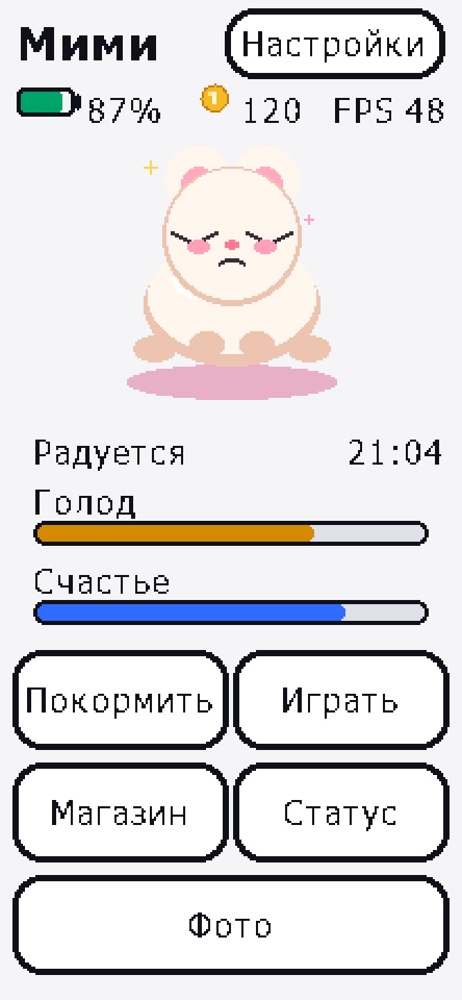
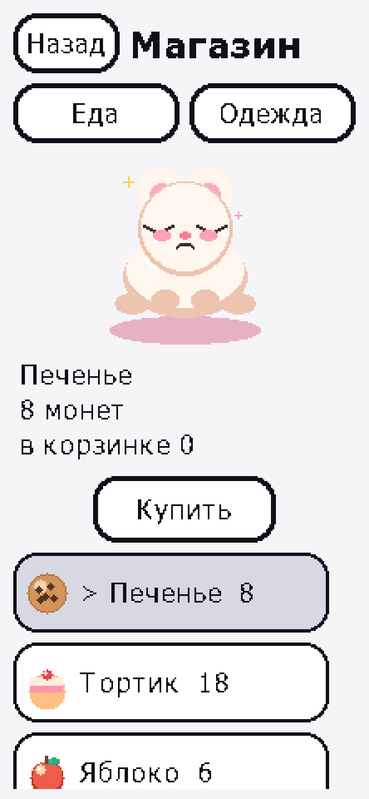
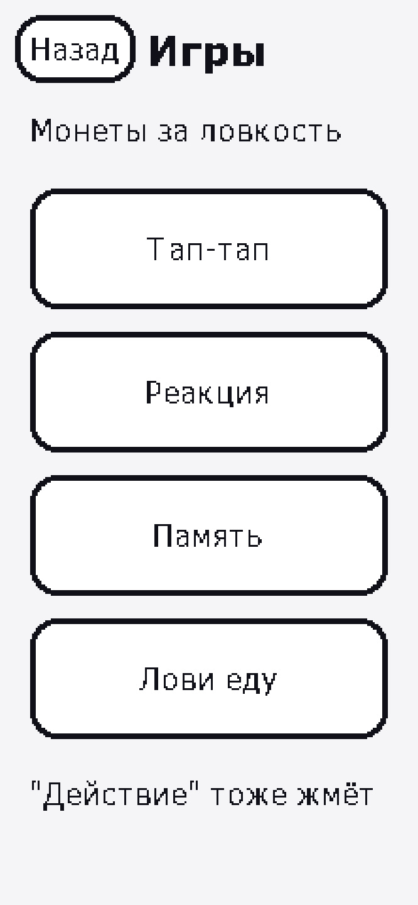
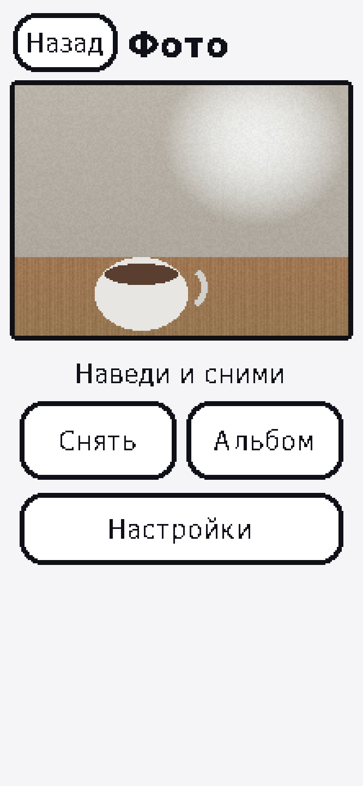
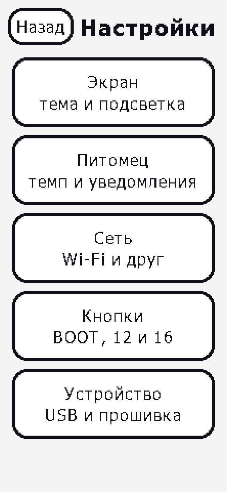

# Tamagotchi для LilyGO T-Display-S3-Pro

Виртуальный питомец для [LilyGO T-Display-S3-Pro](https://github.com/Xinyuan-LilyGO/T-Display-S3-Pro): портрет 222×480, сенсорный экран, камера, microSD, Wi‑Fi и ESP‑NOW.

Стек: **PlatformIO + Arduino (ESP32) + LVGL 8.4 + LovyanGFX + SensorLib**.

Стартовые персонажи — оригинальные **Мими** и **Нори** (процедурная графика). Рисунков чужих IP в репозитории нет; свой арт подключается по [ASSETS.md](ASSETS.md).

Подробное описание экранов со скриншотами: **[docs/FEATURES.md](docs/FEATURES.md)**.

<p align="center">
  
  
  
  
  
</p>

---

## Возможности (кратко)

| Область | Что есть |
| --- | --- |
| Питомец | 2 слота, нужды, уровень/XP/возраст, одежда слоями, сон и уход |
| UI | темы, кириллица, Home на таче, тосты и подтверждения |
| Игры | Тап, Реакция, Память, Лови еду; минимум 1 монета за партию |
| Магазин | еда, лекарство, одежда, превью, инвентарь |
| Камера | превью, JPEG на SD, выбор размера кадра, вспышка, альбом, «Зеркало» |
| Сейв | NVS + LittleFS, бэкап SD, [редактор на ПК](tools/save_editor/) |
| Wi‑Fi | SoftAP настройки, NTP, страница статуса + HTTP‑сейв, OTA |
| ESP‑NOW | подарок монет между двумя платами |
| Питание | таймеры подсветки; при гашении экрана — энергосбережение |

---

## Железо

| Параметр | Значение |
| --- | --- |
| MCU | ESP32-S3R8 |
| Flash / PSRAM | 16 МБ / 8 МБ OPI |
| Дисплей | 2.33″ ST7796, 222×480, SPI |
| Тач | CST226SE / CST816S (I2C) |
| Камера | DVP OV2640 / OV5640 (опциональный шилд) |
| SD | microSD, общая SPI с дисплеем, CS = GPIO 14 |
| PMU | SY6970 |
| Кнопки | BOOT (0), GPIO 12, GPIO 16 + Home на таче |

Пины — в `include/board_config.h` (карта LilyGO).

---

## Сборка и прошивка

### Требования
- [PlatformIO](https://platformio.org/) (CLI или расширение VS Code / Cursor)
- Плата по USB‑C
- Python 3 (для редактора сейва и конвертера спрайтов)

### Команды

```bash
pio run                 # сборка: app, firmware.ota.bin и firmware.full.bin
pio run -t upload       # полная прошивка по USB (таблица разделов + приложение)
pio run -t uploadfs     # залить data/ → LittleFS (спрайты)
pio device monitor      # лог 115200
```

В `platformio.ini` порт можно задать явно (`upload_port` / `monitor_port`), если автоопределение не сработает. `monitor_rts` и `monitor_dtr` выключены, чтобы монитор не перезагружал плату по кругу. Номер COM консоли может смениться после прошивки.

По умолчанию USB‑C — обычный COM-порт. Настройки → **Устройство** → **USB флешка** перезагружает плату и отдаёт microSD компьютеру как диск «Tama microSD». Та же кнопка, «Безопасное извлечение» на ПК или сброс питания возвращают COM-порт. Пока режим включён, фото и бэкап на самой плате недоступны, а для новой прошивки сначала выключи режим или сними питание.

Прошивка рассчитана на **16 МБ flash + 8 МБ OPI PSRAM** (`qio_opi`). Два слота приложения по 3 МБ (`ota_0` / `ota_1`), сейв LittleFS по-прежнему с адреса `0x610000`.

| Файл | Что это |
| --- | --- |
| `.pio/build/tdisplay-s3-pro/firmware.full.bin` | загрузчик, таблица разделов, otadata и приложение. Пишется с адреса `0x0`. Нужна при первой установке и когда меняется таблица разделов |
| `.pio/build/tdisplay-s3-pro/firmware.ota.bin` | только приложение. Этот файл заливается со страницы обновления на устройстве |

Полный образ (режим flash DIO, как в `platformio.ini`):

```bash
python -m esptool --chip esp32s3 --port COM9 --baud 115200 --before default-reset --after hard-reset write-flash --flash-mode dio --flash-freq 80m --flash-size 16MB 0x0 .pio/build/tdisplay-s3-pro/firmware.full.bin
```

Первая запись новой таблицы разделов ужимает NVS на 4 КБ под служебный раздел OTA. Пароль Wi‑Fi и мелкие настройки из NVS могут сброситься. Игровой сейв в LittleFS лежит по тому же адресу и остаётся.

Версия задаётся в `include/version.h` (`FW_VERSION_STR`). Её видно внизу экрана настроек.

**Обновление с телефона:** Настройки → **Обновление** → сеть `TamaUpdate` / `tamagotchi` → `http://192.168.4.1` → выбрать `firmware.ota.bin`. Питание не отключать до перезагрузки. Полный образ через эту страницу не принимается.

Типичный размер: ~1.2 МБ flash, ~40 % внутренней RAM (кадры камеры — в PSRAM).

---

## Управление

| Ввод | Действие |
| --- | --- |
| Касание | Кнопки UI |
| Home на рамке тача | На главный экран |
| GPIO 0 (BOOT) | По умолчанию «Назад». Удержание при включении — режим прошивки |
| GPIO 12 | По умолчанию «Действие»: на главном — покормить, в играх — нажатие |
| GPIO 16 | По умолчанию «Дальше»: Главная → Игры → Магазин → Статус → Настройки |

Настройки → **Кнопки** меняет действие каждой кнопки: Назад, Дальше, Действие, Корм, Игры, Магазин, Статус, Настройки, Домой, Сон или Нет. В игре посторонние действия не срабатывают, пока партия не закончена.

Если касания перевёрнуты: пять быстрых тапов по счётчику **FPS** (если включён) — перебор режимов 0–7, пишется в сейв и UART.

---

## Структура репозитория

```
├── include/           board_config.h, lv_conf.h
├── src/               прошивка (hw, pet, games, ui, storage)
├── data/pet/          опциональные .rgb спрайты
├── docs/
│   ├── FEATURES.md    возможности со скриншотами
│   └── screenshots/   макеты экранов
├── tools/
│   ├── save_editor/   Python UI для бэкапа сейва
│   ├── gen_assets.py
│   └── png_to_rgb565.py
├── partitions.csv
├── platformio.ini
├── ASSETS.md
└── README.md
```

---

## Настройка под свою плату

| Симптом | Что сделать |
| --- | --- |
| Картинка съехала вбок | `LCD_OFFSET_X` в `board_config.h` (49 / 0 / 35) |
| Красный ↔ синий | `LV_COLOR_16_SWAP` в `include/lv_conf.h` |
| Подсветка V1.0 (ШИМ) | раскомментировать `-DUSE_BL_PWM` в `platformio.ini` |
| Медленные нужды | Настройки → **Темп нужд** (30 с / 5 мин / 30 мин) |
| Пищалка | свободный GPIO → `PIN_BUZZER` |

---

## Wi‑Fi и время (кратко)

1. Настройки → **Wi‑Fi настройка** → подключиться к `TamaSetup` / `tamagotchi`  
2. Открыть `192.168.4.1`, ввести домашнюю сеть  
3. Устройство синхронизирует NTP и гасит радио  
4. Дальше: **Синхр. время** или авто‑NTP  

**Страница статуса:** SoftAP `TamaStatus` → те же учётные данные → статы и HTTP‑сейв.

Пока экран погашен, авто‑Wi‑Fi не поднимается (энергосбережение).

---

## microSD

- Фото: `/photos/p_XXXXXXXXXX.jpg`  
- Бэкапы сейва: `/backup/save_XXXXXXXXXX.bin`  
- Без карты съёмка и бэкап показывают тост «Нет SD»; игровой сейв в LittleFS от этого не зависит  

Редактор на ПК: см. [tools/save_editor/README.md](tools/save_editor/README.md).

---

## Лицензия

Код, документация и оригинальные материалы проекта распространяются по [Creative Commons Attribution 4.0](https://creativecommons.org/licenses/by/4.0/deed.ru) (CC BY 4.0). Полный текст лицензии лежит в файле [LICENSE](LICENSE).

Проект можно копировать, изменять и распространять, в том числе в коммерческих сборках. Нужно указать автора **Dron_WiC**, дать ссылку на этот репозиторий и отметить, что именно изменено.

Библиотеки LVGL, LovyanGFX, SensorLib и ядро Arduino-ESP32 остаются под своими лицензиями.

В публичные копии не добавляйте чужие товарные персонажи и чужие защищённые рисунки. Свой арт подключается по [ASSETS.md](ASSETS.md).
