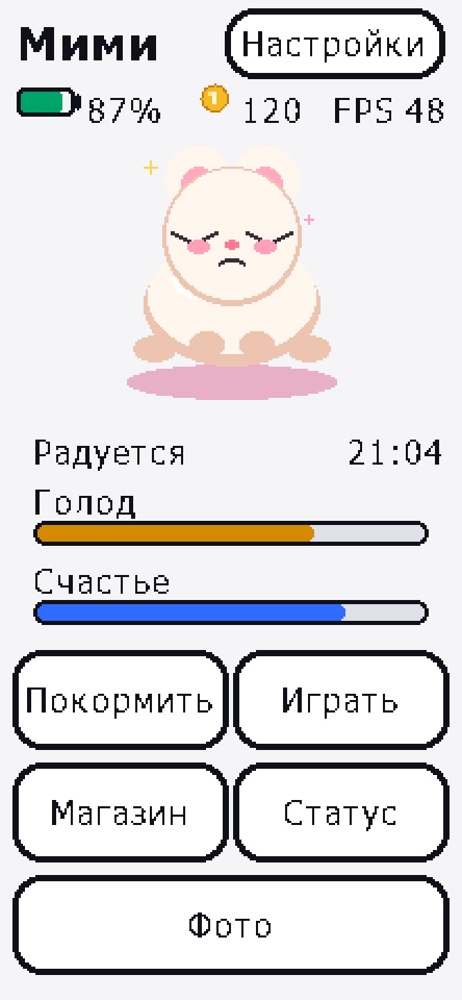
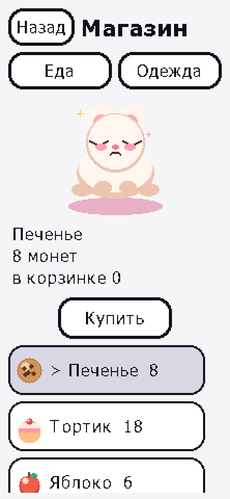
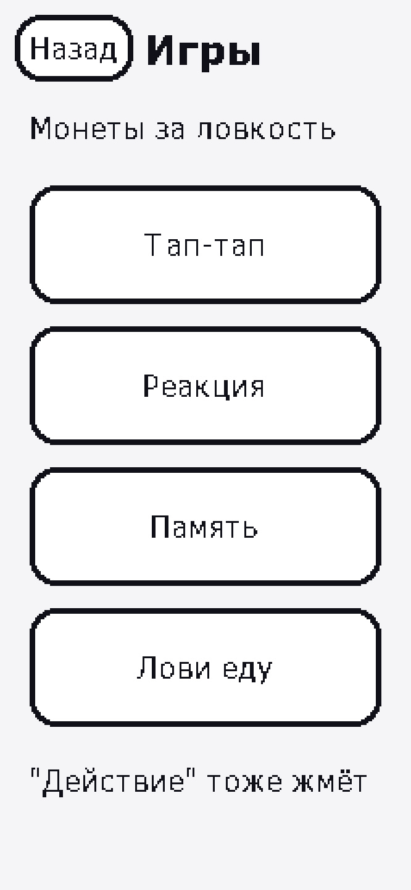
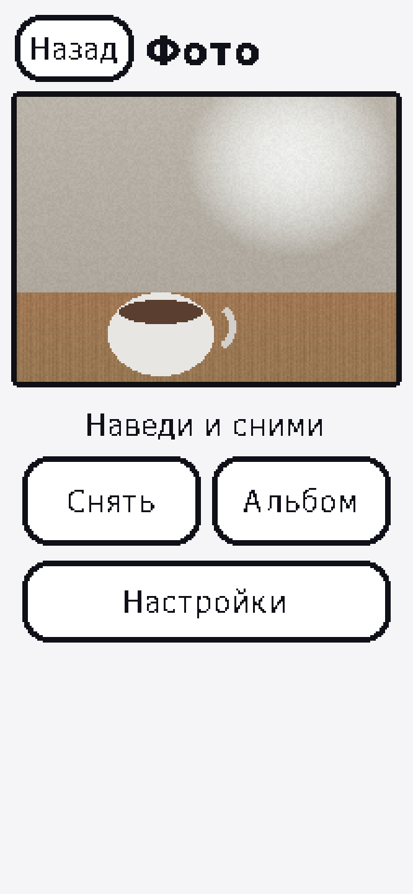
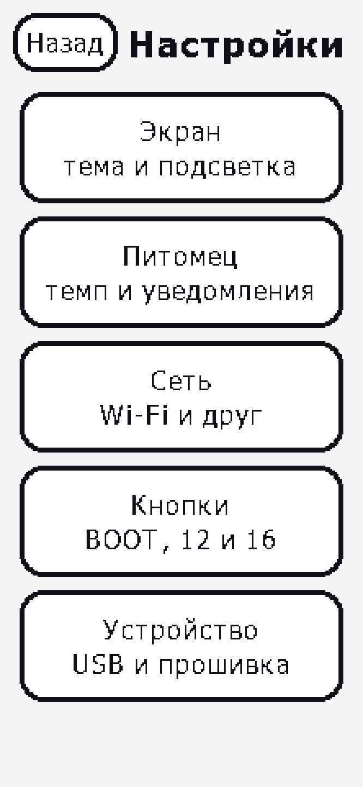
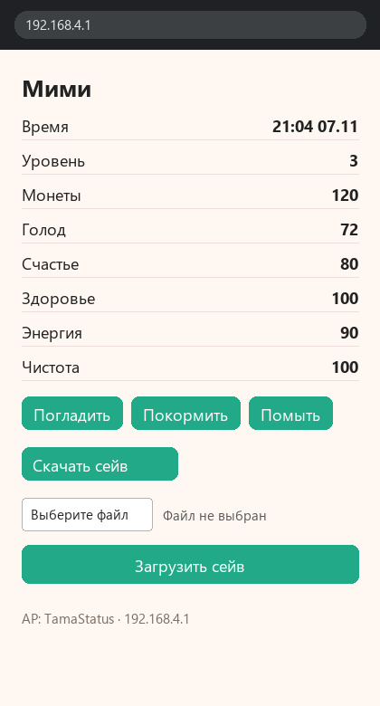
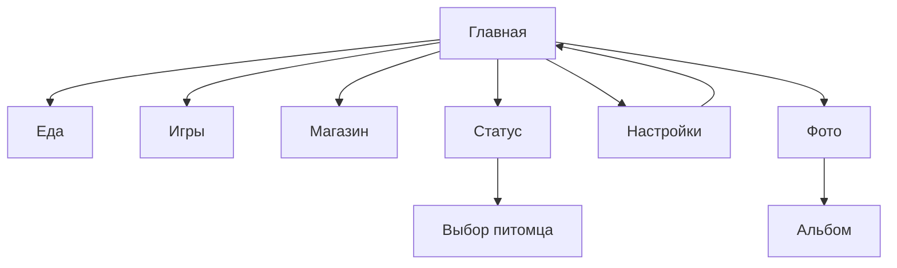

# Возможности прошивки

Документ описывает реализованный функционал Tamagotchi для LilyGO T-Display-S3-Pro.  
Иллюстрации повторяют экран устройства: портрет 222×480, тот же шрифт и те же отступы.

---

## Главный экран

Питомцы **Мими** и **Нори**, индикаторы батареи и монет, часы (после NTP), полоски голода и счастья.

| Действие | Куда |
| --- | --- |
| Покормить | экран еды |
| Играть | меню мини-игр |
| Магазин | еда и одежда |
| Статус | подробные статы, сон, смена питомца |
| Фото | камера |
| Настройки | разделы Экран, Питомец, Сеть, Устройство |

Аппаратная кнопка **Home** на рамке тача возвращает на главный экран.

---

## Магазин

Вкладки **Еда** и **Одежда**, покупка за монеты, предпросмотр вещи на питомце, инвентарь купленного. **Лекарство** поднимает здоровье и не кормит; при полном здоровье не тратится. На игры оно не влияет.

---

## Мини-игры

Четыре игры с наградой монетами (и влиянием на настроение / энергию). Законченная партия всегда даёт хотя бы 1 монету; при низком здоровье или силах выплата вдвое меньше, но не нулевая. Играть можно и когда питомец болеет или устал — закрыт только сон.

1. **Тап** — быстрые нажатия  
2. **Реакция** — успеть вовремя  
3. **Память** — повторить ряд  
4. **Лови еду** — поймать падающие предметы  

Во время игры подсветка не гаснет.

---

## Камера и альбом

Требуется камера OV2640/OV5640 и microSD.

- Живой видоискатель (QQVGA)  
- **Снять** → JPEG в `/photos/` на карте (оверлей питомца). Размер кадра: Настройки → Устройство → **Размер фото** (от 160×120 до 1024×768)  
- **Вспышка** (GPIO 38)  
- **Альбом** — листание, превью, удаление с подтверждением  
- **Зеркало** — реакция на яркость и резкое движение в кадре  

Без карты показывается «Нет SD»; сейв игры в LittleFS от этого не зависит.

---

## Настройки и повседневное

Список разбит на пять разделов. **Назад** из раздела возвращает к списку, из списка — на главный экран.

- **Экран** — тема, яркость, таймауты, счётчик FPS  
- **Питомец** — темп нужд, ночной сон, тихая ночь, уведомления  
- **Сеть** — часы, Wi‑Fi, страница статуса, ESP‑NOW  
- **Кнопки** — действие для BOOT, GPIO 12 и GPIO 16  
- **Устройство** — вспышка камеры, размер фото, USB-флешка (microSD для ПК), сейв на SD, версия, обновление, сброс  

- Тема: светлая / тёмная  
- Яркость, таймауты приглушения и гашения экрана  
- Авто NTP, ночной сон (22:00–08:00), тихая ночь  
- **Уведомления** — тосты при пробуждении экрана («Пора покормить» и т.п.); выключаются в настройках  
- **Темп нужд** — 30 с / 5 мин / 30 мин, в том числе пока плата была выключена  
- Wi‑Fi: настройка SoftAP, синхронизация времени, страница статуса, выключение радио  
- ESP‑NOW: слушать друга / подарок 5 монет  
- Бэкап и восстановление сейва с microSD  
- **USB флешка** — по умолчанию кабель это обычный COM-порт. Настройки → Устройство включает диск «Tama microSD» и перезагружает плату. Та же кнопка, безопасное извлечение на ПК или сброс питания возвращают COM-порт. Пока диск включён, фото и бэкап на устройстве недоступны  
- **Прошивка** — номер версии и обновление по Wi‑Fi (SoftAP `TamaUpdate`, файл `firmware.ota.bin`)  
- Сброс устройства (сейв + Wi‑Fi credentials)  

### Энергосбережение

Когда подсветка гаснет по таймауту:

- от батареи CPU 80 МГц, сенсор не опрашивается, экран включает любая физическая кнопка (не сброс питания)  
- на зарядке CPU остаётся 240 МГц, экран включает и касание  
- LVGL и отрисовка по SPI не выполняются  
- авто‑Wi‑Fi не поднимается  
- цикл опроса ~200 мс

---

## Wi‑Fi: страница статуса

SoftAP **`TamaStatus`** (пароль `tamagotchi`) → в браузере `http://192.168.4.1`

- Живые статы питомца  
- Кнопки: погладить / покормить / помыть  
- Скачать и загрузить бинарный сейв (`save.bin`)  

Настройка домашней сети: SoftAP **`TamaSetup`** → форма SSID/пароль → NTP → радио гасится.

---

## Сохранение прогресса

| Место | Назначение |
| --- | --- |
| NVS + LittleFS `/save.bin` | основной сейв на устройстве |
| microSD `/backup/save_*.bin` | бэкап / обмен с ПК |
| microSD `/photos/*.jpg` | снимки камеры |

Редактор бэкапа на ПК: [`tools/save_editor/`](../tools/save_editor/README.md) (Python + tkinter, формат SaveData v3).

---

## Связь между двумя платами

1. На обеих: Настройки → **Сеть** → **Слушать друга** (ESP‑NOW)  
2. На одной: **Подарок 5 монет** (списываются у отправителя, зачисляются получателю)  

Радио и SoftAP одновременно не используются: при старте одной функции другая останавливается.

---

## Статус питомца (на устройстве)

Подробные полоски нужд, возраст, уровень, опыт, кнопки помыть / спать / сменить питомца / сброс текущего прогресса питомца (отдельно от полного сброса устройства).

---

## Краткая карта экранов

Подробности сборки и железа — в корневом [README.md](../README.md). Свои спрайты — [ASSETS.md](../ASSETS.md).
